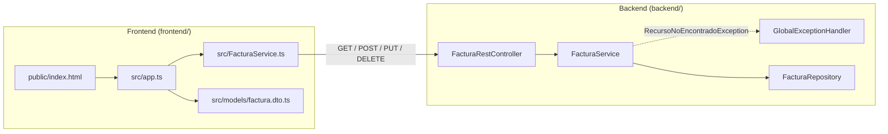

# Plan de Implementación: TP CRUD Factura de Venta

## Descripción del Objetivo

Implementar las operaciones CRUD de Factura de Venta (Backend Spring Boot + JPA y Frontend TypeScript + HTML5) cumpliendo estrictamente con las 7 consignas de [TRABAJO_PRACTICO_CRUD_FACTURA_VENTA.md](file:///E:/Informacion/Santi/facu/3ro/Desarrollo%20de%20software/TP_SpringBoot_Grupal/v2/TRABAJO_PRACTICO_CRUD_FACTURA_VENTA.md), partiendo de [tp-anterior](file:///E:/Informacion/Santi/facu/3ro/Desarrollo%20de%20software/TP_SpringBoot_Grupal/v2/tp-anterior/tp3-spring-boot-jpa/proyecto-grupal-jpa) y siguiendo las guías [EjemploTypeScriptSpring](file:///E:/Informacion/Santi/facu/3ro/Desarrollo%20de%20software/TP_SpringBoot_Grupal/v2/EjemploTypeScriptSpring) y [EjemploAplicacionControllerAdvice.md](file:///E:/Informacion/Santi/facu/3ro/Desarrollo%20de%20software/TP_SpringBoot_Grupal/v2/EjemploAplicacionControllerAdvice.md).

---

## Directivas Estrictas de "Estilo Humano" (Anti-AI Code Smells)

> [!IMPORTANT]
> Durante la fase de escritura de código se respetarán de forma obligatoria las siguientes reglas:
> - **Cero comentarios obvios:** Prohibido comentar lo evidente (`// Guardar factura`, `// Inyectar servicio`, `// Setear id`). Solo se admiten comentarios breves en fórmulas de negocio no triviales (cálculo de bonificación e IVA).
> - **Cero Javadocs mecánicos:** No generar bloques `@param`, `@return` ni `@author` en métodos CRUD cotidianos.
> - **Sin advertencias de "tutorial":** Prohibido incluir comentarios como `// En producción considerar...` o `// TODO: implementar lógica real`.
> - **Mimetismo con el código existente (`tp-anterior`):**
>   - Mantener la inyección de dependencias con `@Autowired` sobre atributos en `Service` y `Controller`, igual que en [FacturaService.java](file:///E:/Informacion/Santi/facu/3ro/Desarrollo%20de%20software/TP_SpringBoot_Grupal/v2/tp-anterior/tp3-spring-boot-jpa/proyecto-grupal-jpa/src/main/java/tp/FacturaService.java) y [FacturaRestController.java](file:///E:/Informacion/Santi/facu/3ro/Desarrollo%20de%20software/TP_SpringBoot_Grupal/v2/tp-anterior/tp3-spring-boot-jpa/proyecto-grupal-jpa/src/main/java/tp/FacturaRestController.java).
>   - Mantener `java.util.Date` en entidades y DTOs respetando el modelo JPA original de [FacturaVenta.java](file:///E:/Informacion/Santi/facu/3ro/Desarrollo%20de%20software/TP_SpringBoot_Grupal/v2/tp-anterior/tp3-spring-boot-jpa/proyecto-grupal-jpa/src/main/java/tp/FacturaVenta.java), sin mezclar `LocalDate` ni `LocalDateTime`.
>   - Mantener todo el dominio y nomenclatura en español.

---

## Arquitectura del Proyecto



---

## Objetivos Principales y Objetivos Secundarios

---

### Objetivo Principal 1: Preparar las Carpetas Base (`backend/` y `frontend/`)

#### Objetivo Secundario 1.1: Copiar `tp-anterior` en `backend/`
- Copiar el proyecto de [tp-anterior/tp3-spring-boot-jpa/proyecto-grupal-jpa](file:///E:/Informacion/Santi/facu/3ro/Desarrollo%20de%20software/TP_SpringBoot_Grupal/v2/tp-anterior/tp3-spring-boot-jpa/proyecto-grupal-jpa) a `backend/`.

#### Objetivo Secundario 1.2: Crear `frontend/` a partir de `EjemploTypeScriptSpring/AppNodeJS`
- Copiar `package.json`, `tsconfig.json` y el servidor Express (`src/index.ts`) desde [EjemploTypeScriptSpring/AppNodeJS](file:///E:/Informacion/Santi/facu/3ro/Desarrollo%20de%20software/TP_SpringBoot_Grupal/v2/EjemploTypeScriptSpring/AppNodeJS) hacia `frontend/`, dejando únicamente los archivos requeridos por las consignas:
  - `frontend/src/models/factura.dto.ts`
  - `frontend/src/FacturaService.ts`
  - `frontend/src/app.ts`
  - `frontend/public/index.html`

---

### Objetivo Principal 2: Implementar los DTOs en el Backend (Consigna 1)

#### Objetivo Secundario 2.1: Crear `FacturaDetalleRequestDTO` (Consigna 1.a y 1.b)
##### [NEW] `backend/src/main/java/tp/FacturaDetalleRequestDTO.java`
```java
package tp;

import lombok.AllArgsConstructor;
import lombok.Getter;
import lombok.NoArgsConstructor;
import lombok.Setter;

@Getter
@Setter
@NoArgsConstructor
@AllArgsConstructor
public class FacturaDetalleRequestDTO {
    private Long articuloId;
    private String descripcion;
    private double cantidad;
    private double precioUnitario;
    private double porcentajeBonificacion;
}
```

#### Objetivo Secundario 2.2: Crear `FacturaRequestDTO` (Consigna 1.a y 1.b)
##### [NEW] `backend/src/main/java/tp/FacturaRequestDTO.java`
```java
package tp;

import lombok.AllArgsConstructor;
import lombok.Getter;
import lombok.NoArgsConstructor;
import lombok.Setter;

import java.util.Date;
import java.util.List;

@Getter
@Setter
@NoArgsConstructor
@AllArgsConstructor
public class FacturaRequestDTO {
    private Long numero;
    private Date fechaEmision;
    private Long clienteId;
    private Long condicionIvaId;
    private Long puntoVentaId;
    private Long tipoMonedaId;
    private String estado;
    private String observaciones;
    private List<FacturaDetalleRequestDTO> detalles;
}
```

#### Objetivo Secundario 2.3: Actualizar `FacturaReporteDTO`
Agregar `id` y `estado` en [FacturaReporteDTO.java](file:///E:/Informacion/Santi/facu/3ro/Desarrollo%20de%20software/TP_SpringBoot_Grupal/v2/tp-anterior/tp3-spring-boot-jpa/proyecto-grupal-jpa/src/main/java/tp/FacturaReporteDTO.java) manteniendo el constructor usado por `MainReportes.java`:

##### [MODIFY] `backend/src/main/java/tp/FacturaReporteDTO.java`
```java
package tp;

import lombok.AllArgsConstructor;
import lombok.Getter;
import lombok.NoArgsConstructor;
import lombok.Setter;
import java.util.Date;

@Getter
@Setter
@AllArgsConstructor
@NoArgsConstructor
public class FacturaReporteDTO {
    private Long id;
    private Long numeroFactura;
    private Date fechaEmision;
    private String clienteDenominacion;
    private String condicionIva;
    private String puntoVentaDescripcion;
    private double importeTotal;
    private long cantidadItems;
    private String estado;

    public FacturaReporteDTO(Long numeroFactura, Date fechaEmision, String clienteDenominacion,
                             String condicionIva, String puntoVentaDescripcion,
                             double importeTotal, long cantidadItems) {
        this.numeroFactura = numeroFactura;
        this.fechaEmision = fechaEmision;
        this.clienteDenominacion = clienteDenominacion;
        this.condicionIva = condicionIva;
        this.puntoVentaDescripcion = puntoVentaDescripcion;
        this.importeTotal = importeTotal;
        this.cantidadItems = cantidadItems;
    }
}
```

---

### Objetivo Principal 3: Manejo de Excepciones con `@RestControllerAdvice` (`EjemploAplicacionControllerAdvice.md`)

#### Objetivo Secundario 3.1: Crear la excepción `RecursoNoEncontradoException`
##### [NEW] `backend/src/main/java/tp/RecursoNoEncontradoException.java`
```java
package tp;

public class RecursoNoEncontradoException extends RuntimeException {
    public RecursoNoEncontradoException(String mensaje) {
        super(mensaje);
    }
}
```

#### Objetivo Secundario 3.2: Crear `ErrorResponse` unificando el estilo con Lombok y `java.util.Date`
##### [NEW] `backend/src/main/java/tp/ErrorResponse.java`
```java
package tp;

import lombok.AllArgsConstructor;
import lombok.Getter;
import lombok.NoArgsConstructor;
import lombok.Setter;
import java.util.Date;

@Getter
@Setter
@NoArgsConstructor
@AllArgsConstructor
public class ErrorResponse {
    private int status;
    private String mensaje;
    private Date fecha;

    public ErrorResponse(int status, String mensaje) {
        this.status = status;
        this.mensaje = mensaje;
        this.fecha = new Date();
    }
}
```

#### Objetivo Secundario 3.3: Crear `GlobalExceptionHandler`
##### [NEW] `backend/src/main/java/tp/GlobalExceptionHandler.java`
```java
package tp;

import org.springframework.http.HttpStatus;
import org.springframework.web.bind.annotation.ExceptionHandler;
import org.springframework.web.bind.annotation.ResponseStatus;
import org.springframework.web.bind.annotation.RestControllerAdvice;

@RestControllerAdvice
public class GlobalExceptionHandler {

    @ExceptionHandler(RecursoNoEncontradoException.class)
    @ResponseStatus(HttpStatus.NOT_FOUND)
    public ErrorResponse manejarRecursoNoEncontrado(RecursoNoEncontradoException ex) {
        return new ErrorResponse(404, ex.getMessage());
    }
}
```

---

### Objetivo Principal 4: Lógica de Negocio en `FacturaRepository` y `FacturaService` (Consigna 2)

#### Objetivo Secundario 4.1: Métodos semánticos concretos en `FacturaRepository`
En [FacturaRepository.java](file:///E:/Informacion/Santi/facu/3ro/Desarrollo%20de%20software/TP_SpringBoot_Grupal/v2/tp-anterior/tp3-spring-boot-jpa/proyecto-grupal-jpa/src/main/java/tp/FacturaRepository.java), sin métodos genéricos comodín, definir operaciones específicas del dominio de facturación y usar `@PersistenceContext private EntityManager em;` en `FacturaService` para resolver las referencias por ID con `em.find(...)`:
- Actualizar `buscarFacturasFiltradas` para proyectar `f.id` y `f.estado` en `FacturaReporteDTO`.
- `Optional<FacturaVenta> buscarPorId(Long id)` (`Optional.ofNullable(em.find(FacturaVenta.class, id))`).
- `Optional<ListaPrecioArticulo> buscarListaPrecioPorArticuloId(Long articuloId)` mediante consulta JPQL `SELECT lpa FROM ListaPrecioArticulo lpa WHERE lpa.articulo.id = :articuloId`.
- `FacturaVenta guardar(FacturaVenta factura)` (`persist` si `id == null`, `merge` si ya existe).
- `void eliminar(FacturaVenta factura)` (`em.remove(factura)`).

#### Objetivo Secundario 4.2: Creación en cascada en `FacturaService.crear(FacturaRequestDTO)` (Consigna 2.a y 2.b)
En [FacturaService.java](file:///E:/Informacion/Santi/facu/3ro/Desarrollo%20de%20software/TP_SpringBoot_Grupal/v2/tp-anterior/tp3-spring-boot-jpa/proyecto-grupal-jpa/src/main/java/tp/FacturaService.java):
- Inyectar `@Autowired private FacturaRepository facturaRepository;` y `@PersistenceContext private EntityManager em;`.
- Anotar el método con `@Transactional`.
- Buscar las entidades relacionadas mediante `em.find(...)` (`PuntoVenta`, `CondicionIva`, `TipoMoneda`, `Cliente`) y el `ListaPrecioArticulo` por `articuloId`. Si alguna no existe, lanzar `RecursoNoEncontradoException`.
- Obtener un usuario existente para cumplir con los campos obligatorios (`nullable = false`) de [`AuditoriaApp`](file:///E:/Informacion/Santi/facu/3ro/Desarrollo%20de%20software/TP_SpringBoot_Grupal/v2/tp-anterior/tp3-spring-boot-jpa/proyecto-grupal-jpa/src/main/java/tp/AuditoriaApp.java) (por ejemplo con `Usuario usuario = em.find(Usuario.class, 1L);`) y asignarlo antes de persistir:
  ```java
  factura.setUsuarioCarga(usuario);
  factura.setUsuarioModificacion(usuario);
  ```
- Instanciar `FacturaVenta`, inicializar su lista `new ArrayList<>()`, y por cada `FacturaDetalleRequestDTO`:
  - Calcular `importeNeto`, `importeIva` (21%) e `importeSubtotal`.
  - **Establecer explícitamente la relación bidireccional** antes de persistir:
    ```java
    detalle.setFactura(factura);
    factura.getDetalles().add(detalle);
    ```
- Asignar `importeTotal` sumando los subtotales, persistir con `facturaRepository.guardar(factura)` y devolver el `FacturaReporteDTO`.

#### Objetivo Secundario 4.3: Actualización y Anulación en `FacturaService` con `@Transactional` (Consigna 2.c)
Manejar de forma segura tanto el payload parcial de `actualizarEstado` (`{ estado, observaciones }` donde `detalles` es `null`) como una actualización completa:
- Buscar la factura con `facturaRepository.buscarPorId(id).orElseThrow(() -> new RecursoNoEncontradoException("No existe la factura con id " + id))`.
- Actualizar `estado` y `observaciones` (y si `"ANULADA".equalsIgnoreCase(dto.getEstado())`, asignar `factura.setFechaAnulacion(new Date())`).
- Ejecutar la actualización de cabecera e ítems **únicamente si `dto.getDetalles() != null && !dto.getDetalles().isEmpty()`** (evitando `NullPointerException` cuando solo se anula la factura):
  - Actualizar las relaciones de cabecera (`PuntoVenta`, `CondicionIva`, `Cliente`, `TipoMoneda`, `fechaEmision`).
  - **Prohibido hacer `factura.setDetalles(...)`** para no romper la referencia de la colección gestionada por Hibernate con `orphanRemoval = true`. En su lugar:
    ```java
    factura.getDetalles().clear();
    for (FacturaVentaDetalle nuevoDetalle : nuevosDetalles) {
        nuevoDetalle.setFactura(factura);
    }
    factura.getDetalles().addAll(nuevosDetalles);
    ```
  - Recalcular `importeTotal`.

#### Objetivo Secundario 4.4: Eliminación en `FacturaService.eliminar(Long id)` con `@Transactional` (Consigna 2.d)
- Buscar la factura por `id` o lanzar `RecursoNoEncontradoException`.
- Invocar `facturaRepository.eliminar(factura)`.

---

### Objetivo Principal 5: Exponer Endpoints en `FacturaRestController` (Consigna 3)

#### Objetivo Secundario 5.1: Mapear `POST`, `PUT` y `DELETE` en `/api/facturas`
##### [MODIFY] `backend/src/main/java/tp/FacturaRestController.java`
```java
package tp;

import org.springframework.beans.factory.annotation.Autowired;
import org.springframework.format.annotation.DateTimeFormat;
import org.springframework.http.HttpStatus;
import org.springframework.http.ResponseEntity;
import org.springframework.web.bind.annotation.*;

import java.util.Date;
import java.util.List;

@CrossOrigin(origins = "*", allowedHeaders = "*")
@RestController
@RequestMapping("/api/facturas")
public class FacturaRestController {

    @Autowired
    private FacturaService facturaService;

    @GetMapping
    public List<FacturaReporteDTO> buscarFacturasFiltradas(
            @RequestParam(required = false) @DateTimeFormat(pattern = "yyyy-MM-dd") Date fechaDesde,
            @RequestParam(required = false) @DateTimeFormat(pattern = "yyyy-MM-dd") Date fechaHasta,
            @RequestParam(required = false) String estado,
            @RequestParam(required = false) Double montoMinimo) {

        return facturaService.buscarFacturasFiltradas(fechaDesde, fechaHasta, estado, montoMinimo);
    }

    @PostMapping
    public ResponseEntity<FacturaReporteDTO> crear(@RequestBody FacturaRequestDTO dto) {
        FacturaReporteDTO creada = facturaService.crear(dto);
        return ResponseEntity.status(HttpStatus.CREATED).body(creada);
    }

    @PutMapping("/{id}")
    public ResponseEntity<FacturaReporteDTO> actualizar(@PathVariable Long id, @RequestBody FacturaRequestDTO dto) {
        FacturaReporteDTO actualizada = facturaService.actualizar(id, dto);
        return ResponseEntity.ok(actualizada);
    }

    @DeleteMapping("/{id}")
    public ResponseEntity<Void> eliminar(@PathVariable Long id) {
        facturaService.eliminar(id);
        return ResponseEntity.noContent().build();
    }
}
```

---

### Objetivo Principal 6: Interfaces y `FacturaService.ts` en el Frontend (Consignas 5 y 6)

#### Objetivo Secundario 6.1: Crear `src/models/factura.dto.ts` (Consigna 5)
##### [NEW] `frontend/src/models/factura.dto.ts`
```typescript
export interface FacturaDetalleRequestDTO {
    articuloId: number;
    descripcion: string;
    cantidad: number;
    precioUnitario: number;
    porcentajeBonificacion: number;
}

export interface FacturaRequestDTO {
    numero?: number;
    fechaEmision: string;
    clienteId?: number;
    condicionIvaId: number;
    puntoVentaId: number;
    tipoMonedaId?: number;
    estado?: string;
    observaciones?: string;
    detalles: FacturaDetalleRequestDTO[];
}

export interface FacturaReporteDTO {
    id: number;
    numeroFactura: number;
    fechaEmision: string;
    clienteDenominacion: string;
    condicionIva: string;
    puntoVentaDescripcion: string;
    importeTotal: number;
    cantidadItems: number;
    estado: string;
}

export interface FacturaFiltrosDTO {
    fechaDesde?: string;
    fechaHasta?: string;
    estado?: string;
    montoMinimo?: string;
}
```

#### Objetivo Secundario 6.2: Crear `src/FacturaService.ts` siguiendo el estilo de `facturaVentaApi.ts` (Consigna 6)
Adoptar las funciones limpias `manejarRespuesta<T>` y `construirQueryString` de [facturaVentaApi.ts](file:///E:/Informacion/Santi/facu/3ro/Desarrollo%20de%20software/TP_SpringBoot_Grupal/v2/EjemploTypeScriptSpring/AppNodeJS/src/facturaVentaApi.ts) dentro de la clase `FacturaService`:

##### [NEW] `frontend/src/FacturaService.ts`
```typescript
import {
    FacturaFiltrosDTO,
    FacturaReporteDTO,
    FacturaRequestDTO
} from './models/factura.dto.js';

const API_BASE_URL = 'http://localhost:8080/api/facturas';

export class FacturaService {

    private async manejarRespuesta<T>(respuesta: Response): Promise<T> {
        if (!respuesta.ok) {
            const mensaje = await respuesta.text();
            throw new Error(`Error ${respuesta.status}: ${mensaje || respuesta.statusText}`);
        }
        if (respuesta.status === 204) {
            return undefined as T;
        }
        return respuesta.json() as Promise<T>;
    }

    private construirQueryString(filtros: FacturaFiltrosDTO): string {
        const params = new URLSearchParams();
        Object.entries(filtros).forEach(([clave, valor]) => {
            if (valor !== undefined && valor !== null && String(valor).trim() !== '') {
                params.append(clave, String(valor));
            }
        });
        const query = params.toString();
        return query ? `?${query}` : '';
    }

    async obtenerFacturas(filtros: FacturaFiltrosDTO = {}): Promise<FacturaReporteDTO[]> {
        const url = `${API_BASE_URL}${this.construirQueryString(filtros)}`;
        const respuesta = await fetch(url);
        return this.manejarRespuesta<FacturaReporteDTO[]>(respuesta);
    }

    async crearFactura(factura: FacturaRequestDTO): Promise<FacturaReporteDTO> {
        const respuesta = await fetch(API_BASE_URL, {
            method: 'POST',
            headers: { 'Content-Type': 'application/json' },
            body: JSON.stringify(factura)
        });
        return this.manejarRespuesta<FacturaReporteDTO>(respuesta);
    }

    async actualizarEstado(id: number, estado: string, observaciones?: string): Promise<FacturaReporteDTO> {
        const respuesta = await fetch(`${API_BASE_URL}/${id}`, {
            method: 'PUT',
            headers: { 'Content-Type': 'application/json' },
            body: JSON.stringify({ estado, observaciones })
        });
        return this.manejarRespuesta<FacturaReporteDTO>(respuesta);
    }

    async eliminarFactura(id: number): Promise<void> {
        const respuesta = await fetch(`${API_BASE_URL}/${id}`, {
            method: 'DELETE'
        });
        return this.manejarRespuesta<void>(respuesta);
    }
}
```

---

### Objetivo Principal 7: Interfaz `index.html` y Lógica Modular en `app.ts` (Consigna 7)

#### Objetivo Secundario 7.1: Diseñar `public/index.html` (Consigna 7.a)
##### [NEW] `frontend/public/index.html`
- Contenedor de notificaciones en el DOM (`<div id="mensaje-estado"></div>`) para mostrar errores o avisos sin usar `alert()`.
- **Sección 1**: Formulario de búsqueda con filtros (`fechaDesde`, `fechaHasta`, `estado`, `montoMinimo`).
- **Sección 2**: Formulario de alta de factura con inputs para `numero`, `fechaEmision`, `puntoVentaId`, `clienteId`, `condicionIvaId`, `tipoMonedaId` y tabla dinámica de detalles (`#detalles-tbody`).
- **Sección 3**: Tabla de comprobantes registrados (`#facturas-tbody`) con columna de acciones (**Anular** y **Eliminar**).

#### Objetivo Secundario 7.2: Implementar `src/app.ts` sin `alert()` intrusivos (Consigna 7.b)
##### [NEW] `frontend/src/app.ts`
- Seguir la estructura modular de [facturas.ts](file:///E:/Informacion/Santi/facu/3ro/Desarrollo%20de%20software/TP_SpringBoot_Grupal/v2/EjemploTypeScriptSpring/AppNodeJS/src/facturas.ts) y [factura-form.ts](file:///E:/Informacion/Santi/facu/3ro/Desarrollo%20de%20software/TP_SpringBoot_Grupal/v2/EjemploTypeScriptSpring/AppNodeJS/src/factura-form.ts) (`formatearFecha`, `formatearMoneda`, `crearBoton`, `renderizarFacturas`, `crearFilaDetalle`, `renderizarDetalles`).
- Mostrar los errores y confirmaciones de estado en `#mensaje-estado` dentro del DOM y registrar errores técnicos con `console.error(...)` (cero llamadas a `alert()`).

---

## Plan de Verificación

### Compilación
1. **Backend**: `cd backend && .\gradlew.bat compileJava`
2. **Frontend**: `cd frontend && npm install && npm run build`

### Verificación Funcional
1. Iniciar el backend (`Application.java` en puerto `8080`) y el frontend (`npm start` en puerto `3000`).
2. Comprobar desde `http://localhost:3000/index.html`:
   - Búsqueda con filtros (`GET /api/facturas`).
   - Alta de factura con múltiples ítems en cascada (`POST /api/facturas` -> `201 Created`).
   - Anulación de factura desde la fila (`PUT /api/facturas/{id}` -> `200 OK`).
   - Eliminación de factura desde la fila (`DELETE /api/facturas/{id}` -> `204 No Content`).
   - Visualización de mensaje de error en el DOM cuando se ingresa un ID inexistente (`404 Not Found` vía `@RestControllerAdvice`).
